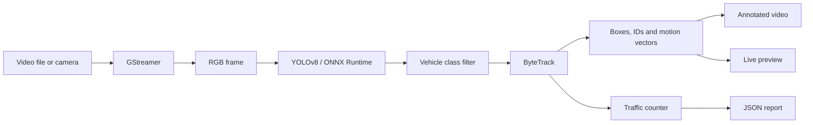

<div align="center">

# Rust Vehicle Detection & Tracking

**Real-time vehicle detection, multi-object tracking and traffic analytics powered by YOLOv8, ByteTrack and GStreamer.**


[English](README.md) | [Русский](README_RU.md)

</div>

## About

This project is a video analytics pipeline written in Rust. It detects vehicles with a YOLOv8 model exported to ONNX, assigns persistent IDs with ByteTrack, visualizes movement and produces a machine-readable traffic report.

It can process an H.264 video file or capture frames from a live camera. Every processed frame is annotated and written to an output video; live mode also displays a real-time preview.

## Features

- YOLOv8 inference through ONNX Runtime
- ByteTrack-based multi-object tracking
- Vehicle-only filtering before the tracking stage
- Persistent display IDs for tracked objects
- Bounding boxes, class labels and confidence scores
- Motion vectors showing the direction of travel
- Smoothed processing FPS overlay
- H.264 video-file input
- Live camera capture and preview through GStreamer
- Annotated video export
- JSON traffic report grouped by vehicle class
- Bounded frame channel to keep the processing pipeline predictable

### Tracked classes

The detector uses the standard COCO class IDs and passes only road vehicles to ByteTrack.

| Vehicle | COCO class ID | Overlay color |
|---|---:|---|
| Bicycle | 1 | Orange |
| Car | 2 | Green |
| Motorcycle | 3 | Red |
| Bus | 5 | Blue |
| Truck | 7 | Purple |

People and unrelated COCO classes are discarded before tracking, drawing and traffic reporting.

## Processing pipeline



## Requirements

- Rust **1.85 or newer** (Rust 2024 edition)
- A YOLOv8 model exported to ONNX
- ONNX Runtime shared library
- GStreamer development files and runtime plugins
- FFmpeg development libraries
- `pkg-config`, or an explicit `FFMPEG_LIB_DIR`
- LLVM/Clang when required by native dependency bindings

The file-input pipeline currently uses these GStreamer elements:

```text
qtdemux -> h264parse -> avdec_h264 -> videoconvert
```

Make sure the GStreamer base, good, bad and libav plugin sets are installed and available on `PATH`.

## Setup

Clone the repository and enter the project directory:

```bash
git clone <repository-url>
cd car_detector
```

Place a compatible ONNX model in the project directory or pass an absolute model path when running the application.

### Windows environment

Native libraries should be configured through environment variables rather than hard-coded paths. In PowerShell:

```powershell
$env:PATH = "C:\path\to\gstreamer\bin;C:\path\to\onnxruntime\lib;$env:PATH"
$env:FFMPEG_LIB_DIR = "C:\path\to\ffmpeg\lib"
```

You may also pass the ONNX Runtime DLL directly with `--onnx-runtime-path`:

```powershell
--onnx-runtime-path "C:\path\to\onnxruntime\lib\onnxruntime.dll"
```

If `pkg-config` can locate FFmpeg, `FFMPEG_LIB_DIR` is optional.

## Usage

Build and run in release mode. Neural-network inference is significantly slower in an unoptimized debug build.

### Process a video

```bash
cargo run --release -- --model-name ./yolov8n.onnx --input-video-path ./input.mp4 --output-video-path ./output.mp4
```

With an explicit ONNX Runtime library:

```bash
cargo run --release -- --model-name ./yolov8n.onnx --onnx-runtime-path /path/to/libonnxruntime.so --input-video-path ./input.mp4 --output-video-path ./output.mp4
```

### Process a live camera stream

```bash
cargo run --release -- --model-name ./yolov8n.onnx --output-video-path ./camera-output.mp4 --live-stream
```

Live mode captures the default camera through `autovideosrc`, displays the processed stream and saves it at the same time.

### Command-line options

| Option | Short | Required | Description |
|---|---:|---:|---|
| `--model-name <PATH>` | `-m` | Yes | Path to the YOLOv8 ONNX model |
| `--input-video-path <PATH>` | `-i` | File mode | Input video path; omitted in live mode |
| `--output-video-path <PATH>` | `-o` | Yes | Destination for the annotated video |
| `--onnx-runtime-path <PATH>` | — | No | Explicit path to the ONNX Runtime shared library |
| `--live-stream` | `-l` | No | Capture from the default camera instead of a file |
| `--help` | `-h` | No | Print the complete CLI help |

## Output

### Annotated video

The generated video contains:

- class-colored bounding boxes;
- vehicle type, tracking ID and confidence;
- motion vectors derived from the previous tracked position;
- smoothed tracker FPS in the upper-right corner.

### Traffic report

After a successful run, the application writes a report to:

```text
src/report/report.json
```

Each section maps the internal ByteTrack UUID to the shorter ID displayed in the video:

```json
{
  "Cars": {
    "f6c8931a-63ef-4bd4-9107-b63822112cf1": 1
  },
  "Buses": {},
  "Motorcycles": {},
  "Trucks": {},
  "bicycles": {}
}
```

## Project structure

```text
src/
├── cli.rs               Command-line interface
├── detection.rs         Detection type used by ByteTrack
├── draw.rs              Bounding boxes, text, FPS and vectors
├── main.rs              Application pipeline and frame loop
├── streamer.rs          GStreamer input and live preview
├── tracker.rs           YOLO inference and ByteTrack integration
├── traffic_counter.rs   Per-class traffic aggregation and JSON export
└── util.rs              Frame conversion, class filtering and helpers
```

## Performance notes

- Always benchmark with `cargo run --release` or a release binary.
- Model inference is the dominant part of the frame-processing time.
- `yolov8n.onnx` offers a better speed/accuracy trade-off for CPU inference than larger YOLO variants.
- The displayed FPS measures the processing pipeline, not the source video's declared frame rate.
- Logging inside the per-frame loop can noticeably distort performance measurements.

## Current limitations

- File input currently expects an H.264 stream in a container supported by `qtdemux`.
- Live capture uses the default camera and requests a 1920×1080 RGB stream.
- The traffic report is saved only after a graceful end of stream.
- Inference performance depends heavily on the selected model and ONNX Runtime execution provider.

## Built with

- [Rust](https://www.rust-lang.org/)
- [YOLOv8](https://github.com/ultralytics/ultralytics)
- [ONNX Runtime](https://onnxruntime.ai/)
- [GStreamer](https://gstreamer.freedesktop.org/)
- [ByteTrack](https://github.com/ifzhang/ByteTrack)
- [`image`](https://crates.io/crates/image) and [`imageproc`](https://crates.io/crates/imageproc)

---

<div align="center">
Built in Rust as a practical experiment in real-time computer vision and video analytics.
</div>
