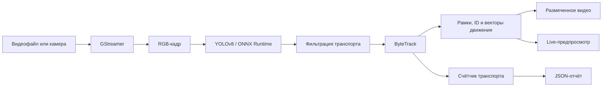

<div align="center">

# Детекция и трекинг транспорта на Rust

**Детекция транспорта в реальном времени, многобъектный трекинг и аналитика трафика на базе YOLOv8, ByteTrack и GStreamer.**


[English](README.md) | [Русский](README_RU.md)

</div>

## О проекте

Это написанный на Rust пайплайн видеоаналитики. Он обнаруживает транспорт с помощью модели YOLOv8, экспортированной в ONNX, назначает объектам постоянные идентификаторы через ByteTrack, визуализирует их движение и формирует машиночитаемый отчёт о трафике.

Приложение умеет обрабатывать H.264-видеофайлы и получать кадры с камеры в реальном времени. Каждый обработанный кадр размечается и записывается в выходное видео, а в режиме камеры также отображается в окне предпросмотра.

## Возможности

- Инференс YOLOv8 через ONNX Runtime
- Многобъектный трекинг на базе ByteTrack
- Фильтрация классов транспорта до этапа трекинга
- Постоянные отображаемые ID отслеживаемых объектов
- Рамки, названия классов и значения уверенности модели
- Векторы движения, показывающие направление транспорта
- Сглаженный FPS обработки поверх кадра
- Обработка H.264-видеофайлов
- Захват изображения с камеры и live-предпросмотр через GStreamer
- Сохранение размеченного видео
- JSON-отчёт с группировкой транспорта по классам
- Ограниченный канал кадров для предсказуемой работы пайплайна

### Отслеживаемые классы

Детектор использует стандартные идентификаторы классов COCO и передаёт в ByteTrack только дорожный транспорт.

| Транспорт | ID класса COCO | Цвет рамки |
|---|---:|---|
| Велосипед | 1 | Оранжевый |
| Автомобиль | 2 | Зелёный |
| Мотоцикл | 3 | Красный |
| Автобус | 5 | Синий |
| Грузовик | 7 | Фиолетовый |

Люди и остальные классы COCO отбрасываются до трекинга, отрисовки и формирования отчёта.

## Пайплайн обработки



## Требования

- Rust **1.85 или новее** (редакция Rust 2024)
- Модель YOLOv8, экспортированная в ONNX
- Динамическая библиотека ONNX Runtime
- Файлы разработки и runtime-плагины GStreamer
- Библиотеки разработки FFmpeg
- `pkg-config` либо явно заданный `FFMPEG_LIB_DIR`
- LLVM/Clang, если они требуются для генерации биндингов нативных зависимостей

Текущий пайплайн чтения видео использует следующие элементы GStreamer:

```text
qtdemux -> h264parse -> avdec_h264 -> videoconvert
```

Убедитесь, что установлены наборы плагинов GStreamer base, good, bad и libav, а их исполняемые файлы доступны через `PATH`.

## Установка

Клонируйте репозиторий и перейдите в каталог проекта:

```bash
git clone <repository-url>
cd car_detector
```

Поместите совместимую ONNX-модель в каталог проекта либо передайте абсолютный путь к ней при запуске приложения.

### Настройка окружения в Windows

Пути к нативным библиотекам следует задавать через переменные окружения, не прописывая их непосредственно в коде. Пример для PowerShell:

```powershell
$env:PATH = "C:\path\to\gstreamer\bin;C:\path\to\onnxruntime\lib;$env:PATH"
$env:FFMPEG_LIB_DIR = "C:\path\to\ffmpeg\lib"
```

Путь к DLL ONNX Runtime также можно передать напрямую через `--onnx-runtime-path`:

```powershell
--onnx-runtime-path "C:\path\to\onnxruntime\lib\onnxruntime.dll"
```

Если `pkg-config` самостоятельно находит FFmpeg, переменная `FFMPEG_LIB_DIR` не обязательна.

## Использование

Собирайте и запускайте приложение в release-режиме. В неоптимизированной debug-сборке инференс нейронной сети работает значительно медленнее.

### Обработка видео

```bash
cargo run --release -- --model-name ./yolov8n.onnx --input-video-path ./input.mp4 --output-video-path ./output.mp4
```

Запуск с явным указанием библиотеки ONNX Runtime:

```bash
cargo run --release -- --model-name ./yolov8n.onnx --onnx-runtime-path /path/to/libonnxruntime.so --input-video-path ./input.mp4 --output-video-path ./output.mp4
```

### Обработка видеопотока с камеры

```bash
cargo run --release -- --model-name ./yolov8n.onnx --output-video-path ./camera-output.mp4 --live-stream
```

В live-режиме приложение получает кадры с камеры по умолчанию через `autovideosrc`, показывает обработанный поток и одновременно сохраняет его в видеофайл.

### Параметры командной строки

| Параметр | Короткая форма | Обязательный | Описание |
|---|---:|---:|---|
| `--model-name <PATH>` | `-m` | Да | Путь к ONNX-модели YOLOv8 |
| `--input-video-path <PATH>` | `-i` | Для файла | Путь к исходному видео; не используется в live-режиме |
| `--output-video-path <PATH>` | `-o` | Да | Путь для сохранения размеченного видео |
| `--onnx-runtime-path <PATH>` | — | Нет | Явный путь к динамической библиотеке ONNX Runtime |
| `--live-stream` | `-l` | Нет | Получать кадры с камеры по умолчанию вместо файла |
| `--help` | `-h` | Нет | Показать полную справку по CLI |

## Результат работы

### Размеченное видео

В выходном видео отображаются:

- рамки, цвет которых зависит от класса транспорта;
- тип транспорта, ID трека и уверенность модели;
- векторы движения, рассчитанные по предыдущей позиции объекта;
- сглаженный FPS трекера в правом верхнем углу.

### Отчёт о трафике

После успешного завершения приложение сохраняет отчёт в файл:

```text
src/report/report.json
```

В каждой секции внутренний UUID ByteTrack сопоставляется с коротким ID, отображаемым в видео:

```json
{
  "Cars": {
    "f6c8931a-63ef-4bd4-9107-b63822112cf1": 1
  },
  "Buses": {},
  "Motorcycles": {},
  "Trucks": {},
  "bicycles": {}
}
```

## Структура проекта

```text
src/
├── cli.rs               Аргументы командной строки
├── detection.rs         Тип детекции для ByteTrack
├── draw.rs              Рамки, текст, FPS и векторы движения
├── main.rs              Пайплайн приложения и цикл обработки кадров
├── streamer.rs          Получение кадров и live-предпросмотр через GStreamer
├── tracker.rs           Интеграция YOLO и ByteTrack
├── traffic_counter.rs   Подсчёт транспорта и экспорт JSON
└── util.rs              Конвертация кадров, фильтрация классов и утилиты
```

## Производительность

- Для измерений всегда используйте `cargo run --release` или release-сборку приложения.
- Инференс модели занимает основную часть времени обработки кадра.
- При работе на CPU `yolov8n.onnx` обеспечивает более выгодный баланс скорости и точности, чем крупные варианты YOLO.
- FPS на изображении отражает скорость обработки, а не заявленную частоту кадров исходного видео.
- Вывод в консоль внутри покадрового цикла может заметно искажать результаты измерений.

## Текущие ограничения

- Видеофайл должен содержать H.264-поток в контейнере, поддерживаемом `qtdemux`.
- В live-режиме используется камера по умолчанию и запрашивается RGB-поток с разрешением 1920×1080.
- Отчёт о трафике сохраняется только после штатного завершения потока.
- Скорость инференса существенно зависит от выбранной модели и execution provider ONNX Runtime.

## Используемые технологии

- [Rust](https://www.rust-lang.org/)
- [YOLOv8](https://github.com/ultralytics/ultralytics)
- [ONNX Runtime](https://onnxruntime.ai/)
- [GStreamer](https://gstreamer.freedesktop.org/)
- [ByteTrack](https://github.com/ifzhang/ByteTrack)
- [`image`](https://crates.io/crates/image) и [`imageproc`](https://crates.io/crates/imageproc)

---

<div align="center">
Практический проект на Rust в области компьютерного зрения и видеоаналитики реального времени.
</div>
